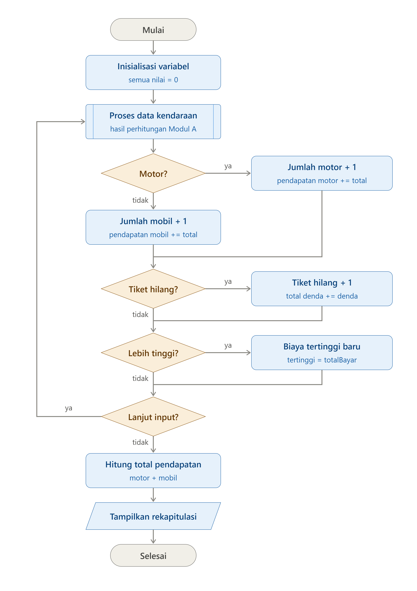

# MODUL B — REKAPITULASI PARKIR

## 1. Penanggung Jawab
Nama: Stephanie Halim Kurniawan
NIM: 322610011

## 2. Tujuan Modal B
Modul B bertujuan untuk mengolah seluruh akumulasi data kendaraan dari Modul A untuk menghitung, merangkum, dan menampilkan laporan rekapitulasi pendapatan parkir harian secara menyeluruh setelah petugas mengakhiri proses input.

## 3. Input Modul B

Modul B tidak meminta data baru dari petugas, kecuali pilihan lanjut atau selesai. Data yang diolah berasal dari Modul A untuk setiap kendaraan:

- Jenis kendaraan (`jenisKendaraan`)
- Status kehilangan tiket (`tiketHilang`)
- Denda (`denda`)
- Total pembayaran (`totalBayar`)
- Pilihan petugas (`pilihan`)

## 4. Proses Modul B

1. Menyiapkan variabel rekapitulasi dengan nilai awal 0.
2. Menerima hasil perhitungan setiap kendaraan dari Modul A.
3. Menambah jumlah motor atau mobil sesuai jenis kendaraan.
4. Menambahkan total pembayaran ke pendapatan motor atau mobil.
5. Jika tiket hilang, menambah jumlah kendaraan kehilangan tiket dan total denda.
6. Membandingkan total pembayaran dengan biaya tertinggi.
7. Meminta pilihan petugas untuk lanjut atau selesai.
8. Menghitung total pendapatan setelah input selesai.
9. Menampilkan seluruh rekapitulasi.

## 5. Algoritma Deskriptif Modul B

1. Mulai.
2. Inisialisasi seluruh variabel rekapitulasi dengan nilai 0.
3. Ambil hasil Modul A.
4. Tambahkan jumlah dan pendapatan sesuai jenis kendaraan.
5. Jika tiket hilang, tambahkan jumlah tiket hilang dan total denda.
6. Perbarui biaya tertinggi jika total pembayaran lebih besar.
7. Tanyakan apakah petugas ingin menginput kendaraan lain.
8. Jika lanjut, ulangi proses kendaraan.
9. Jika selesai, hitung total pendapatan.
10. Tampilkan rekapitulasi.
11. Selesai.

## 6. Pseudocode Modul B
```text
MULAI

jumlahMotor <- 0
jumlahMobil <- 0
jumlahTiketHilang <- 0
pendapatanMotor <- 0
pendapatanMobil <- 0
totalDenda <- 0
biayaTertinggi <- 0
pilihan <- 'Y'

WHILE pilihan = 'Y' DO
    Terima hasil perhitungan Modul A

    IF jenisKendaraan = 'M' THEN
        jumlahMotor <- jumlahMotor + 1
        pendapatanMotor <- pendapatanMotor + totalBayar
    ELSE
        jumlahMobil <- jumlahMobil + 1
        pendapatanMobil <- pendapatanMobil + totalBayar
    END IF

    IF tiketHilang = 'Y' THEN
        jumlahTiketHilang <- jumlahTiketHilang + 1
        totalDenda <- totalDenda + denda
    END IF

    IF totalBayar > biayaTertinggi THEN
        biayaTertinggi <- totalBayar
    END IF

    INPUT pilihan
END WHILE

totalPendapatan <- pendapatanMotor + pendapatanMobil

OUTPUT rekapitulasi parkir

SELESAI
```

## 7. Flowchart Modul B



## 9. Source Code dan Penjelasan

Nama file source code: `modul-b.cpp`

Penjelasan mencakup:
- Deklarasi variabel rekapitulasi
- Perulangan utama
- Input dan validasi
- Perhitungan per kendaraan
- Akumulasi rekapitulasi
- Pilihan lanjut atau selesai
- Output rekapitulasi

## 10. Hasil Eksekusi dan Pengujian
```text
===== REKAPITULASI PARKIR HARIAN =====
Jumlah sepeda motor        : 2
Jumlah mobil               : 2
Kendaraan kehilangan tiket : 2
Pendapatan sepeda motor    : Rp31000
Pendapatan mobil           : Rp64000
Total denda                : Rp70000
Total pendapatan           : Rp95000
Biaya parkir tertinggi     : Rp59000

# 5. Algoritma Deskriptif Modul B

1. Mulai.
2. Ambil hasil perhitungan pembayaran dari Modul A.
3. Simpan data pembayaran untuk proses rekapitulasi.
4. Hitung jumlah sepeda motor.
5. Hitung jumlah mobil.
6. Hitung jumlah kendaraan yang kehilangan tiket.
7. Hitung pendapatan dari sepeda motor.
8. Hitung pendapatan dari mobil.
9. Hitung total denda.
10. Hitung total pendapatan.
11. Tentukan biaya parkir tertinggi.
12. Tampilkan rekapitulasi parkir harian.
13. Selesai.

## 6. Pseudocode Modul B
```text
MULAI

jumlahMotor <- 0
jumlahMobil <- 0
jumlahTiketHilang <- 0
pendapatanMotor <- 0
pendapatanMobil <- 0
totalDenda <- 0
biayaTertinggi <- 0
pilihan <- 'Y'

WHILE pilihan = 'Y' DO
    Terima hasil perhitungan Modul A

    IF jenisKendaraan = 'M' THEN
        jumlahMotor <- jumlahMotor + 1
        pendapatanMotor <- pendapatanMotor + totalBayar
    ELSE
        jumlahMobil <- jumlahMobil + 1
        pendapatanMobil <- pendapatanMobil + totalBayar
    END IF

    IF tiketHilang = 'Y' THEN
        jumlahTiketHilang <- jumlahTiketHilang + 1
        totalDenda <- totalDenda + denda
    END IF

    IF totalBayar > biayaTertinggi THEN
        biayaTertinggi <- totalBayar
    END IF

    INPUT pilihan
END WHILE

totalPendapatan <- pendapatanMotor + pendapatanMobil

OUTPUT rekapitulasi parkir

SELESAI
```
## 9. Source Code dan Penjelasan

Nama file source code: `modul-b.cpp`

Penjelasan mencakup:
- Deklarasi variabel rekapitulasi
- Perulangan utama
- Input dan validasi
- Perhitungan per kendaraan
- Akumulasi rekapitulasi
- Pilihan lanjut atau selesai
- Output rekapitulasi